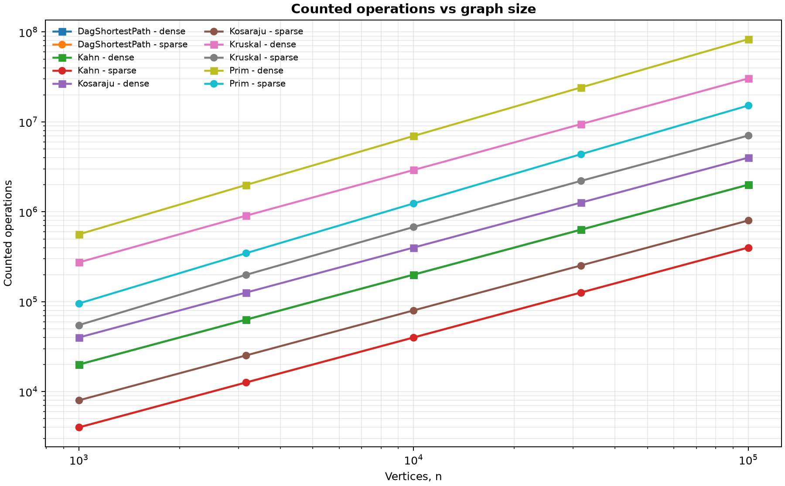
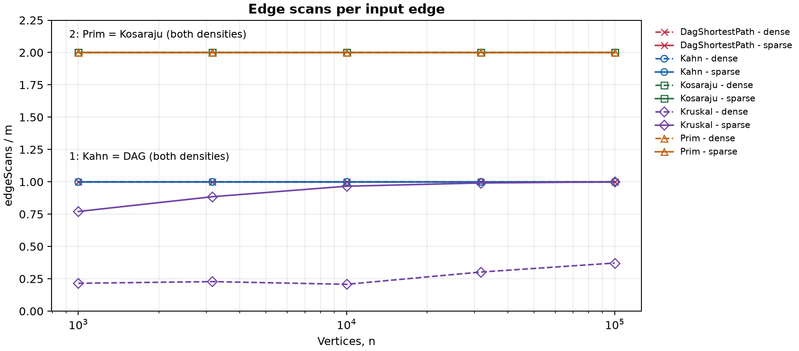
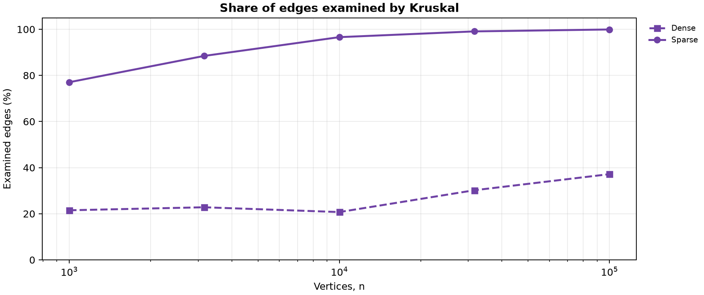

# Assignment 3: Graph Algorithms

## 1. Design, measurement and complexity

The project uses one adjacency-list Graph class for directed and undirected
inputs. Vertices are 0..V-1 and weights are int; totals and distances are long.
An undirected edge occurs once in the edge list and twice in adjacency lists.
Self-loops, parallel edges, isolated vertices and disconnected graphs are supported.
Both MST algorithms return a minimum spanning forest with its component count.
Kosaraju uses explicit DFS frames in both passes, with no recursive calls.

The benchmark uses V = 1,000; 3,162; 10,000; 31,623; 100,000, each with
E=4V and E=20V. Each configuration has three graph kinds, each starting with a
new Random(42). The shuffle, tree, endpoint rejection and weight-generation order
follow the PDF. The phrase "four generated graphs" in Deliverables conflicts with
Section 6; we follow the ten configurations, reference table and 50-row requirement.
"Dense" here means E=20V: both families still have E=Theta(V), not the
E=Theta(V squared) density of a complete graph.

### Counter definitions

dsuOps counts find calls plus successful unions, including finds inside union.
edgeScans counts Kruskal's selection loop, Prim's adjacency traversal, both
Kosaraju DFS passes, Kahn's queue processing or the DAG relaxation pass.
Following the exact 2E/E requirements, reversal, in-degree setup and validation
are excluded from this counter. DAG topological sorting has separate temporary
metrics: it is included in runtime, but not in the relaxation counter.
comparisons counts weight-comparator calls in sort and PriorityQueue.
maxDepth is the largest number of live DFS frames, not a number of operations.
All counters are incremented at actual events, not derived from formulas.

| Algorithm | Time | Extra space | Reason |
|---|---|---|---|
| DSU find / union | Amortized O(alpha(V)) | O(1) per call; O(V) stored | Path compression and union by size; makeSet costs O(V). |
| Kruskal | O(V + E log(E+1) + E alpha(V)) | O(V+E) | Initialize DSU, sort all edges and scan until the tree is complete. |
| Prim, lazy binary heap | O(V + E log(E+1)) | O(V+E) | Scan adjacency lists; up to E candidates enter and leave the heap. |
| Kosaraju | O(V+E) | O(V+E) | Two DFS passes, reversed graph and O(V) stack frames. |
| Kahn | O(V+E) | O(V) | Build in-degrees, enqueue each vertex once and process outgoing edges. |
| DAG shortest paths | O(V+E) | O(V) | Topological sorting, then one relaxation pass. |

Space excludes the input and includes output and temporary storage.
For simple graphs, log E is O(log V); unrestricted parallel edges prevent
assuming this equivalence for our general API. The V term covers edgeless
graphs. DSU's inverse-Ackermann bound is amortized over operations; API-call
counts alone do not measure parent-pointer work or prove that bound.

<!-- pagebreak -->

## 2. Counters versus formulas

Let W = dsuOps + edgeScans + comparisons. This is a work indicator, not every
CPU instruction. We divide W by E log2 E for MST algorithms and by V+E for
traversals. scripts/analyze_results.py validates results.csv and prints the
normalized counters and slopes. Each column below is a measured size.

| Algorithm / density | 1,000 | 3,162 | 10,000 | 31,623 | 100,000 |
|---|---:|---:|---:|---:|---:|
| Kruskal / sparse | 1.147 | 1.157 | 1.108 | 1.029 | 0.946 |
| Kruskal / dense | 0.958 | 0.899 | 0.828 | 0.775 | 0.727 |
| Prim / sparse | 1.996 | 2.012 | 2.026 | 2.039 | 2.042 |
| Prim / dense | 1.965 | 1.972 | 1.979 | 1.982 | 1.985 |
| Kosaraju / sparse | 1.600 | 1.600 | 1.600 | 1.600 | 1.600 |
| Kosaraju / dense | 1.905 | 1.905 | 1.905 | 1.905 | 1.905 |
| Kahn and DAG / sparse | 0.800 | 0.800 | 0.800 | 0.800 | 0.800 |
| Kahn and DAG / dense | 0.952 | 0.952 | 0.952 | 0.952 | 0.952 |

Prim's normalized work is almost constant. Traversal ratios are exactly constant
at fixed density: Kosaraju scans 2E; Kahn and DAG relaxation scan E each.
Kruskal's ratio decreases on larger graphs, so it is not exactly constant.
Adaptive sorting, repeated weights from only 1,000 possible values and early
termination affect these measurements. Results are consistent with the upper
bounds; a finite experiment cannot prove an asymptotic bound or show that every
input needs Theta(E log E) comparisons. Comparison counts can also depend on
JDK collection implementations; reference answers and exact traversal counts do not.

Kruskal's dsuOps/E is 2.290, 2.519, 2.682, 2.732, 2.748 on sparse graphs;
it is 0.580, 0.606, 0.565, 0.754, 0.894 on dense graphs.
S scanned edges and U successful unions cause 2S+2U finds and U union counts,
so dsuOps=2S+3U. For connected graphs U=V-1. We check this relation against
measured counters; the algorithm still increments them at every actual call.

### Log-log slopes

Ordinary least squares fits x=ln(V), y=ln(counter), separately by density:
slope=sum((x-mean(x))(y-mean(y)))/sum((x-mean(x)) squared).

| Algorithm | Scans: sparse / dense | W: sparse / dense |
|---|---|---|
| Kruskal | 1.055 / 1.119 | 1.052 / 1.022 |
| Prim | 1.000 / 1.000 | 1.101 / 1.085 |
| Kosaraju | 1.000 / 1.000 | 1.000 / 1.000 |
| Kahn | 1.000 / 1.000 | 1.000 / 1.000 |
| DAG shortest paths | 1.000 / 1.000 | 1.000 / 1.000 |

The PDF links Kruskal's scan slope to sorting, but edgeScans excludes sorting
comparisons. Its scan slope above 1 comes from the changing examined-edge share;
S is always at most E. Sorting's comparison slopes are separately 1.055 (sparse)
and 1.016 (dense). This distinction avoids attributing logarithmic sorting work
to a selection counter bounded by E.

<!-- pagebreak -->

## 3. Correctness and algorithm choice

### Minimum spanning forests: cut property

Assume the accepted edges form a forest F contained in an optimal forest T.
Choose a cut that no edge of F crosses and a minimum-weight edge e across it.
If e is absent from T, adding it creates a cycle containing another crossing
edge f, and replacing f by e cannot increase total weight.
This exchange preserves F, so e safely extends an optimal solution even with
equal or negative weights.
Kruskal applies this argument to a DSU component by processing edges in
nondecreasing weight order and rejecting edges within the same component.
Prim applies it to the visited set because its cheapest non-stale heap entry
is a lightest crossing edge.
Repeating these safe steps in every component gives a minimum spanning forest
with exactly V-C edges for C components.

### DAG shortest paths: induction on topological order

Initialize every in-degree-zero vertex to distance zero, equivalent to adding
a virtual source with zero-weight edges to all such vertices.
Every vertex in a finite DAG is reachable from a source because following
predecessors must terminate without repeating a vertex.
The source distances form the base case of induction on topological order.
Assume all vertices before the current vertex have their final shortest distances.
Every incoming edge starts at an earlier vertex, so all possible last edges of
paths to the current vertex have already been relaxed.
Its distance is therefore final, and relaxing outgoing edges preserves the
induction hypothesis while parents record a realizing path.
Negative weights are safe because no directed cycle exists; a general graph
may have a negative cycle and no finite shortest walk, while even without
negative cycles it may need repeated relaxation.

### Which algorithm when

| Situation | Choice | Reason |
|---|---|---|
| Undirected, sparse, edge list | Kruskal | Sorting and DSU match the representation. |
| Undirected, adjacency list | Prim | Grows using outgoing edges without globally sorting them. |
| Undirected, truly dense matrix | Array-based Prim | O(V squared) avoids heap costs; not implemented here. |
| E=20V benchmark multigraph | Measured Kruskal implementation | Fewer weight comparisons and selection scans than lazy Prim on these data. |
| Incremental undirected connectivity | DSU | Near-constant union and connectivity queries. |
| Directed, cycles possible | Kosaraju | Finds mutual-reachability groups in O(V+E). |
| Directed dependencies | Kahn | Gives an order or detects a cycle when fewer than V vertices leave the queue. |
| Weighted DAG, negative edges allowed | DAG shortest paths | One relaxation pass after topological sorting. |
| General graph with negative weights | Bellman-Ford | Repeated relaxation and reachable negative-cycle detection. |

Density alone does not make lazy heap Prim better: it may hold O(E) candidates.
An indexed heap with decrease-key has different memory and operation counts.
Both implemented MST methods support disconnected graphs. A singleton SCC
with a self-loop is also a cycle, so SCC size alone cannot detect every deadlock.
Bonus Tarjan and condensation/critical path algorithms are not implemented.

<!-- pagebreak -->

## 4. Operations and scans

Figure 1. Each algorithm and density has a line on log-log axes.
W counts selection/traversal scans, DSU calls and weight comparisons;
maximum stack depth is excluded. Kahn and DAG curves overlap because their
recorded phases scan E edges, although their complete runtimes differ.

Figure 2. Prim and Kosaraju have edgeScans/E=2 for different reasons:
Prim sees two adjacency entries per undirected edge; Kosaraju runs two DFS passes.
Kahn and DAG relaxation have ratio 1. Overlapping curves are labelled.
Flat lines confirm linear edge processing, but exclude heap comparisons and setup.

<!-- pagebreak -->

## 5. Results, edge share and timing

Figure 3. Kruskal examines 77.05% to 99.92% of sparse edges versus 20.74% to
37.18% of dense edges. It still sorts all E edges: stopping early saves DSU
work but does not avoid sorting. Prim scans all 2E adjacency entries and has
more heap comparisons in these runs.

| V | E | MST weight (both) | SCC count | Sum of DAG distances |
|---:|---:|---:|---:|---:|
| 1,000 | 4,000 | 147,970 | 27 | 396,274 |
| 1,000 | 20,000 | 30,363 | 1 | 252,411 |
| 3,162 | 12,648 | 468,911 | 137 | 1,271,911 |
| 3,162 | 63,240 | 97,589 | 1 | 723,157 |
| 10,000 | 40,000 | 1,486,139 | 373 | 3,941,828 |
| 10,000 | 200,000 | 309,550 | 1 | 2,381,342 |
| 31,623 | 126,492 | 4,715,515 | 1,188 | 12,551,891 |
| 31,623 | 632,460 | 968,517 | 1 | 7,376,612 |
| 100,000 | 400,000 | 15,012,094 | 3,923 | 40,096,539 |
| 100,000 | 2,000,000 | 3,056,681 | 1 | 23,512,087 |

All reference values and scan checks passed on 23 October 2026 using OpenJDK
21.0.12.1, Linux amd64, maximum heap 3,072 MiB. Each CSV time is the median
of five algorithm runs; the five samples are sorted in memory and only the
middle value is written to results.csv.
Generation, validation and aggregation are outside the timer; initialization,
reversal and internal topological sorting are inside. No separate warm-up is
used, so JIT effects can dominate small cases: sparse Kahn took 1.937 ms at
V=1,000 but 0.647 ms at V=3,162. At the largest dense input, Kruskal took
678.230 ms, Prim 2,210.110 ms, Kosaraju 604.981 ms, Kahn 140.265 ms and
DAG shortest paths 109.590 ms. Hardware, JVM, GC and background load change
times; counters are the main evidence, and timing cannot establish a universal winner.

All 37 JUnit cases passed: randomized DSU, 100 connected MST comparisons,
100 exhaustive small-forest oracles, SCC versus BFS up to 200 vertices,
topological and cycle checks, 100 DAG/Bellman-Ford comparisons with full path
validation, malformed input and boundary cases. A 100,000-vertex path and cycle
each completed with explicit depth 100,000. The benchmark checks every run's
result and all counters; Python independently checks the CSV references,
scan counts and DSU-call relation, but cannot reconstruct discarded timings.
